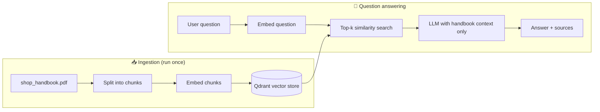

<div align="center">

# 📘 Clause

### A customer-support assistant that answers **only** from your shop handbook

*Built with Retrieval-Augmented Generation (RAG) and running fully local with Ollama.*


</div>

---

## 📑 Table of Contents

- [Overview](#-overview)
- [Key Features](#-key-features)
- [How It Works](#-how-it-works)
- [Tech Stack](#-tech-stack)
- [Project Structure](#-project-structure)
- [Quick Start](#-quick-start)
- [API Reference](#-api-reference)
- [Configuration](#-configuration)
- [Using a Different LLM Provider](#-using-a-different-llm-provider)
- [Troubleshooting](#-troubleshooting)
- [Roadmap](#-roadmap)
- [Author](#-author)

---

## 🔎 Overview

**Clause** is a customer-support assistant for a fictional store, **Clause Shop**. Instead of letting a language model guess, Clause looks every question up in the shop's handbook (a PDF) and answers **only from what it finds**.

Every answer comes with the **sources it used** (file, page number and relevance score), so you can always check where an answer came from. If the handbook doesn't cover a question, Clause says so instead of making something up.

> **Example question:** *"What is the return policy?"*
> Clause retrieves the most relevant handbook passages, answers from them, and returns the page numbers it used.

---

## ✨ Key Features

| | Feature | Description |
|---|---|---|
| 🛡️ | **Grounded answers** | The model sees only the retrieved handbook context, which keeps hallucinations down. |
| 📎 | **Source citations** | Each response includes the source file, page and similarity score. |
| 🔒 | **Runs locally** | Chat model and embeddings run on your machine through Ollama. No API keys needed by default. |
| 🔌 | **Swappable providers** | Switch to Anthropic, OpenAI or Google through configuration. |
| ⚡ | **FastAPI backend** | A clean REST API with automatic interactive docs at `/docs`. |
| 🖥️ | **CLI included** | Ask a question straight from the terminal. |
| ⚙️ | **Fully configurable** | Chunk size, overlap, top-k, models and storage are all set through `.env`. |

---

## 🧠 How It Works

Clause has two phases: **ingestion** (done once) and **question answering** (done on every request).



1. **Load**: the handbook PDF is read from `api/files/shop_handbook.pdf`.
2. **Chunk**: the text is split into overlapping pieces (600 characters with 100 overlap by default).
3. **Embed and store**: each chunk is turned into a vector with `nomic-embed-text` and saved in Qdrant.
4. **Retrieve**: a user's question is embedded and the top-k most similar chunks are fetched (3 by default).
5. **Answer**: the chat model (`gemma3:1b` by default) answers using only those chunks, and the API returns the answer together with its sources.

If nothing relevant is retrieved, the answer states that the handbook doesn't cover the question and `sources` is empty.

---

## 🧰 Tech Stack

| Layer | Technology | Role |
|---|---|---|
| API | **FastAPI** | HTTP endpoints |
| Orchestration | **LangChain** | Model and embedding setup (`init_chat_model`, `init_embeddings`) |
| LLM | **Ollama** with `gemma3:1b` | Local chat model |
| Embeddings | **Ollama** with `nomic-embed-text` | Local text embeddings (768 dimensions) |
| Vector store | **Qdrant** | Embedded on disk by default, or a server |
| Config | **pydantic-settings** | Settings loaded from `.env` |
| Tooling | **uv** | Dependency and environment management |

---

## 📂 Project Structure

```
clause/
├── api/                      # FastAPI RAG backend
│   ├── app/
│   │   ├── main.py           # FastAPI app and routes
│   │   ├── cli.py            # Ask a question from the terminal
│   │   ├── core/
│   │   │   └── config.py     # Settings, embeddings and Qdrant client
│   │   └── services/
│   │       ├── ingestion.py  # Load → chunk → embed → store
│   │       └── chat.py       # RAGService: retrieve → prompt → answer
│   ├── files/
│   │   └── shop_handbook.pdf # Source document
│   ├── vector_stores/        # Local vector store (created by ingestion)
│   ├── .env.example
│   └── pyproject.toml
├── web/                      # Frontend (coming soon)
├── AGENTS.md
├── .gitignore
└── README.md
```

> The `notebooks/` (step-by-step learning notebooks) and `playground/` (standalone RAG experiments) folders are used locally and are not tracked in Git.

---

## 🚀 Quick Start

### Prerequisites

- **Python 3.13+**
- **[uv](https://docs.astral.sh/uv/)**, the Python package manager
- **[Ollama](https://ollama.com/)** installed and running

### 1. Clone the repository

```bash
git clone https://github.com/raeesgul488/clause.git
cd clause
```

### 2. Pull the local models

```bash
ollama pull gemma3:1b
ollama pull nomic-embed-text
```

### 3. Install dependencies and configure

Run all remaining commands from the `api/` folder.

```bash
cd api
uv sync
cp .env.example .env
```

### 4. Ingest the handbook

This builds the Qdrant collection from `files/shop_handbook.pdf`. Run it once, and again whenever the PDF or the chunking and embedding settings change. It **deletes and rebuilds** the collection each time.

```bash
uv run python -c "from app.services.ingestion import ingest; print(ingest(), 'chunks indexed')"
```

### 5. Start the API

```bash
uv run fastapi dev app/main.py
```

The API is now live at **http://127.0.0.1:8000**, with interactive docs at **http://127.0.0.1:8000/docs**. Open the docs page and try `POST /ask`.

### Ask from the terminal (optional)

```bash
uv run python -m app.cli
```

This asks one question and prints the answer.

> ⚠️ **Note:** embedded Qdrant (`RAG_QDRANT_PATH`) can only be opened by **one process at a time**. Stop the API before running the CLI or ingestion, or point `RAG_QDRANT_URL` at a Qdrant server.

---

## 📡 API Reference

### Endpoints

| Method | Path | Description |
|---|---|---|
| `GET` | `/` | Health check, returns `{"status": "ok"}` |
| `POST` | `/ask` | Ask a question about the handbook |

### `POST /ask`

**Request**

```bash
curl -X POST http://127.0.0.1:8000/ask \
  -H "Content-Type: application/json" \
  -d '{"question": "What is the return policy?"}'
```

`question` is required. Whitespace is stripped, and it must be **1 to 2000 characters** long.

**Response**

```json
{
  "answer": "…",
  "sources": [
    { "source": "files/shop_handbook.pdf", "page": 2, "score": 0.7812 }
  ]
}
```

| Field | Meaning |
|---|---|
| `answer` | The model's answer, based only on retrieved handbook text |
| `sources[].source` | File the passage came from |
| `sources[].page` | Page number in the handbook |
| `sources[].score` | Similarity score of the retrieved chunk |

---

## ⚙️ Configuration

All settings are read from `api/.env`, and each one needs the `RAG_` prefix. See [`api/.env.example`](api/.env.example) for the full list.

| Variable | Default | Purpose |
|---|---|---|
| `RAG_CHAT_PROVIDER` | `ollama` | Chat model provider |
| `RAG_CHAT_MODEL` | `gemma3:1b` | Chat model name |
| `RAG_CHAT_TEMPERATURE` | `0.1` | Sampling temperature (low keeps answers focused) |
| `RAG_EMBED_PROVIDER` | `ollama` | Embedding provider |
| `RAG_EMBED_MODEL` | `nomic-embed-text:latest` | Embedding model |
| `RAG_EMBED_DIM` | `768` | Must match the embedding model's output size |
| `RAG_CHUNK_SIZE` | `600` | Characters per chunk |
| `RAG_CHUNK_OVERLAP` | `100` | Overlap between chunks |
| `RAG_TOP_K` | `3` | Chunks retrieved per question |
| `RAG_COLLECTION_NAME` | `shop_handbook` | Qdrant collection name |
| `RAG_QDRANT_PATH` | `./vector_stores` | Local Qdrant storage |
| `RAG_QDRANT_URL` | *(unset)* | Qdrant server URL (overrides the path) |

---

## 🔁 Using a Different LLM Provider

Clause isn't tied to Ollama. To use **Anthropic, OpenAI or Google**:

1. Install that provider's LangChain package.
2. Set the provider, model name and API key in `.env`, as shown in `.env.example`.
3. If you change the **embedding** model, also update `RAG_EMBED_DIM` and **run ingestion again**.

---

## 🩺 Troubleshooting

| Problem | Likely fix |
|---|---|
| Connection errors to the model | Make sure Ollama is running and both models have been pulled. |
| Qdrant "already in use" error | Embedded Qdrant allows one process at a time. Stop the API before running ingestion or the CLI. |
| Answers say the handbook doesn't cover a question | Run ingestion first, then check that `RAG_TOP_K` and the chunk settings suit your document. |
| Vector size mismatch after switching embeddings | Update `RAG_EMBED_DIM` to the new model's output size and re-run ingestion. |

---

## 🗺️ Roadmap

- [ ] Web frontend (`web/`)
- [ ] Support for multiple documents
- [ ] Streaming responses
- [ ] Evaluation set for answer quality

---

## 👤 Author

**Raees Gul**, GitHub: [@raeesgul488](https://github.com/raeesgul488)

If you find this project useful, consider giving it a ⭐.
